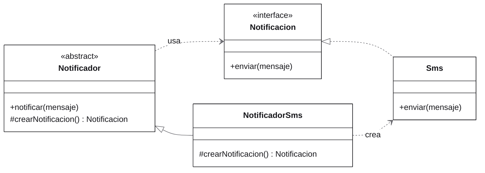
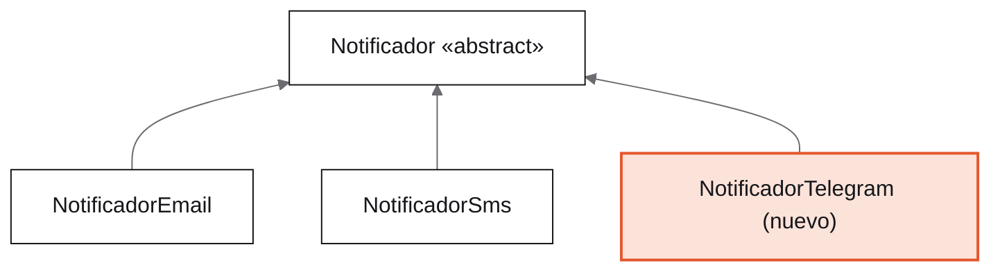
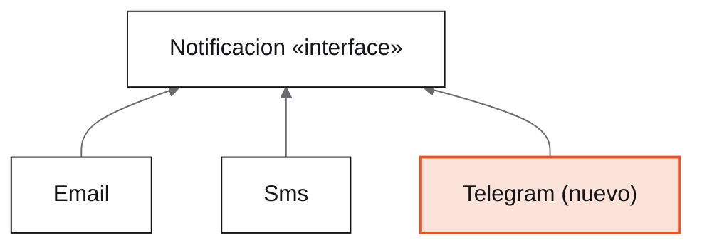
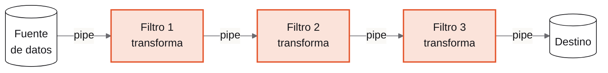
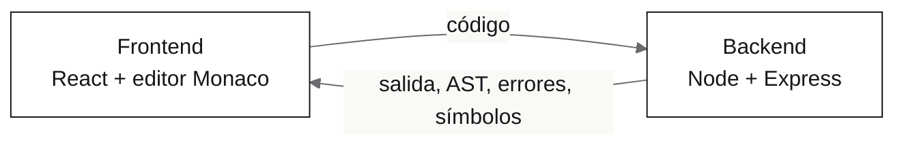
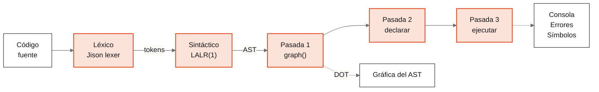
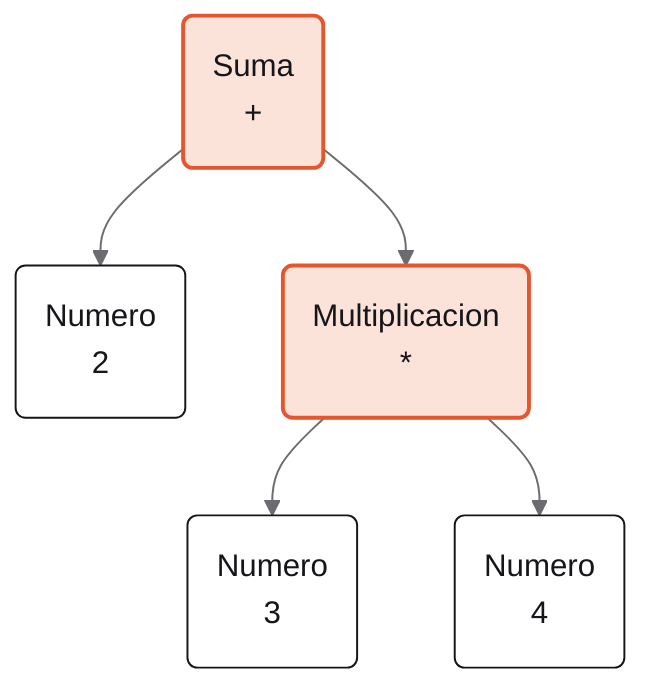
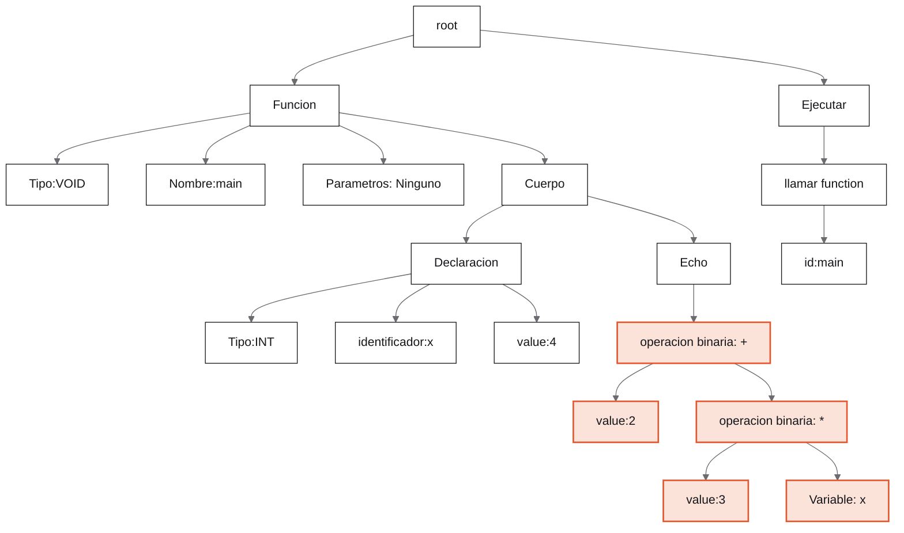
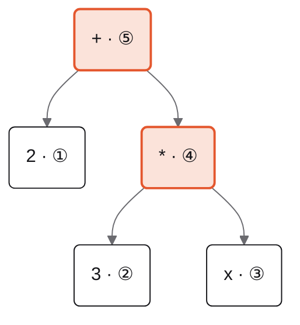

<div class="h-full flex flex-col justify-between">

<div class="kicker">Charla introductoria</div>

<div class="flex items-center justify-between">
  <div>
    <div class="cover-title"><span>Diseñar</span> antes<br/>de codificar</div>
    <div class="text-xl muted mt-6" style="max-width: 30rem">Patrones de Diseño y Arquitectura para Proyectos Escalables</div>
  </div>
  <svg width="300" height="230" viewBox="0 0 300 230" fill="none" class="shrink-0">
    <g stroke-width="1.5" style="stroke: var(--muted)">
      <line x1="150" y1="40" x2="80" y2="115" />
      <line x1="150" y1="40" x2="220" y2="115" />
      <line x1="220" y1="115" x2="170" y2="190" />
      <line x1="220" y1="115" x2="265" y2="190" />
    </g>
    <g text-anchor="middle" dominant-baseline="central" style="font: 500 17px 'JetBrains Mono', monospace">
      <circle cx="150" cy="40" r="24" style="fill: var(--accent)" />
      <text x="150" y="40" fill="#fff">+</text>
      <circle cx="80" cy="115" r="24" stroke-width="1.5" style="fill: var(--bg); stroke: var(--fg)" />
      <text x="80" y="115" style="fill: var(--fg)">2</text>
      <circle cx="220" cy="115" r="24" style="fill: var(--accent)" />
      <text x="220" y="115" fill="#fff">*</text>
      <circle cx="170" cy="190" r="24" stroke-width="1.5" style="fill: var(--bg); stroke: var(--fg)" />
      <text x="170" y="190" style="fill: var(--fg)">3</text>
      <circle cx="265" cy="190" r="24" stroke-width="1.5" style="fill: var(--bg); stroke: var(--fg)" />
      <text x="265" y="190" style="fill: var(--fg)">x</text>
    </g>
  </svg>
</div>

<div class="flex justify-between items-end pt-4" style="border-top: 1px solid var(--rule)">
  <div class="font-semibold">Alvaro Josué Morales Rodríguez</div>
  <div class="mono small muted">2 + 3 * x</div>
</div>

</div>

<!--
Bienvenida y presentación breve.
El árbol de la portada es la expresión 2 + 3 * x: al final de la charla vamos a ver cómo mi intérprete construye exactamente ese árbol.
Rompehielos: "¿Quién ha tenido que rehacer un proyecto desde cero porque ya no se podía modificar?"
-->

---

<div class="kicker">Antes de empezar</div>

# Una historia que tal vez conocen

<div class="grid grid-cols-2 gap-10">
<div>

<div class="rows">
  <div><span>Semana 1</span><div><code>Main.java</code> funciona. Todo bien.</div></div>
  <div><span>Semana 2</span><div>"Solo agrego otro <code>if</code>…"</div></div>
  <div><span>Semana 3</span><div><code>Main.java</code> ya va por las 1,500 líneas.</div></div>
  <div><span>Semana 4</span><div>Arreglo un bug y aparecen dos.</div></div>
  <div><span>Semana 5</span><div>"Mejor lo hago otra vez desde cero."</div></div>
</div>

</div>
<div style="--slidev-code-font-size: 11.5px">

```java
// Main.java, línea 1,342
if (opcion == 1) {
    if (tipo.equals("admin")) {
        if (lista.size() > 0) {
            for (int i = 0; i < lista.size(); i++) {
                if (lista.get(i).getEstado() == 3) {
                    // ¿qué significa 3?
                    // ...
                }
            }
        }
    } else if (tipo.equals("usuario")) {
        // copiado y pegado del bloque de arriba
```

</div>
</div>

<div class="display text-2xl mt-8">
Escribir código es la parte fácil. Lo difícil es <span class="hl">cambiarlo</span> sin romper lo que ya funciona.
</div>

<!--
Contarlo con humor: todos hemos estado ahí.
El problema no fue no saber programar: fue nunca detenerse a pensar en la estructura.
-->

---

<div class="kicker">01 · Diseñar antes de codificar</div>

# ¿Qué significa diseñar?

<div class="grid grid-cols-5 gap-10 mt-2">
<div class="col-span-2">
  <div class="big" style="font-size: 7rem">100×</div>
  <div class="mt-4 leading-snug">más caro puede salir corregir en producción un error que en el diseño se arreglaba borrando una flecha.</div>
  <div class="small muted mt-3">Barry Boehm, <i>Software Engineering Economics</i> (1981)</div>
</div>
<div class="col-span-3">

<div class="ruled">

### Diseñar es

- Pensar qué responsabilidades existen
- Dividir el problema en partes (clases)
- Decidir cómo se comunican esas partes

</div>

<div class="ruled mt-6">

### Diseñar no es

- Escribir un documento de 100 páginas
- Hacer el diagrama UML perfecto
- Pasar meses sin programar

</div>

</div>
</div>

<div class="small muted mt-6">Con papel, lápiz y diez minutos alcanza.</div>

<!--
Analogía rápida: nadie construye una casa sin planos. Mover una pared en el plano es borrar una línea; en la casa construida es romperla.
-->

---

<div class="kicker">01 · Diseñar antes de codificar</div>

# ¿Qué es un proyecto escalable?

Uno que puede crecer sin derrumbarse. ¿Crecer en qué?

<div class="grid grid-cols-3 gap-8 mt-6">
  <div class="ruled">
    <div class="num">01</div>
    <h3>Funcionalidades</h3>
    <div class="small muted">Agregar cosas nuevas sin romper las que ya están.</div>
  </div>
  <div class="ruled">
    <div class="num">02</div>
    <h3>Equipo</h3>
    <div class="small muted">Que varias personas trabajen en el mismo código sin pisarse.</div>
  </div>
  <div class="ruled">
    <div class="num">03</div>
    <h3>Usuarios</h3>
    <div class="small muted">Más usuarios, más datos, más peticiones por segundo.</div>
  </div>
</div>

<div class="grid grid-cols-2 gap-10 mt-10">
<div>

<div class="eyebrow">Señales de alerta</div>

- Cada cambio rompe otra cosa
- Solo una persona entiende el código
- Para agregar algo hay que copiar y pegar algo ya existente

</div>
<div class="callout self-center">
Los <b>patrones de diseño</b> ayudan sobre todo con los dos primeros puntos. Los de <b>arquitectura</b>, con los tres.
</div>
</div>

<!--
Mucha gente piensa que "escalable" solo significa "aguanta muchos usuarios".
En la universidad lo que más duele es escalar en funcionalidades: el proyecto crece y se vuelve imposible de modificar.
-->

---

<div class="kicker">02 · Patrones</div>

# ¿Qué es un patrón?

<div class="display text-3xl leading-tight mt-2" style="max-width: 46rem">
Una <span class="hl">solución probada</span> a un problema que aparece una y otra vez.
</div>

<div class="grid grid-cols-2 gap-10 mt-8">
<div class="ruled">

### Es

- Una idea, una plantilla de solución
- Un vocabulario que comparten los programadores
- Independiente del lenguaje

</div>
<div class="ruled">

### No es

- Una librería que se descarga
- Código para copiar y pegar
- Algo que hay que usar porque sí

</div>
</div>

<div class="muted mt-8">
Como una receta de pepián: la receta no es el pepián. Cada quien lo cocina con lo que tiene, pero todos reconocen el platillo.
</div>

---

<div class="kicker">02 · Patrones</div>

# ¿De dónde vienen?

<div class="relative mt-6">
  <div class="absolute left-0 right-0" style="top: 3.1rem; height: 1.5px; background: var(--rule)"></div>
  <div class="grid grid-cols-5 gap-6 relative">
    <div>
      <div class="display text-3xl font-semibold">1977</div>
      <div class="w-3 h-3 rounded-full mt-2" style="background: var(--accent)"></div>
      <div class="font-semibold mt-4">A Pattern Language</div>
      <div class="small muted mt-1">Christopher Alexander, un arquitecto de edificios.</div>
    </div>
    <div>
      <div class="display text-3xl font-semibold">1987</div>
      <div class="w-3 h-3 rounded-full mt-2" style="background: var(--fg)"></div>
      <div class="font-semibold mt-4">Beck y Cunningham</div>
      <div class="small muted mt-1">Llevan la idea al software.</div>
    </div>
    <div>
      <div class="display text-3xl font-semibold">1994</div>
      <div class="w-3 h-3 rounded-full mt-2" style="background: var(--accent)"></div>
      <div class="font-semibold mt-4">Design Patterns</div>
      <div class="small muted mt-1">El "Gang of Four" publica 23 patrones de diseño.</div>
    </div>
    <div>
      <div class="display text-3xl font-semibold">1996</div>
      <div class="w-3 h-3 rounded-full mt-2" style="background: var(--fg)"></div>
      <div class="font-semibold mt-4">POSA</div>
      <div class="small muted mt-1">Patrones de arquitectura.</div>
    </div>
    <div>
      <div class="display text-3xl font-semibold">Hoy</div>
      <div class="w-3 h-3 rounded-full mt-2" style="background: var(--fg)"></div>
      <div class="font-semibold mt-4">En todos lados</div>
      <div class="small muted mt-1">Java, Js, Ts, Android, React, Fortran xd…</div>
    </div>
  </div>
</div>

<div class="flex gap-4 mt-12">
  <div class="big" style="font-size: 4.5rem; line-height: 0.8">“</div>
  <div>
    <div class="display text-xl leading-snug">Cada patrón describe un problema que ocurre una y otra vez en nuestro entorno, y luego describe el núcleo de la solución a ese problema.</div>
    <div class="small muted mt-3">Christopher Alexander, 1977</div>
  </div>
</div>

<!--
Dato curioso: los patrones de software nacieron de un arquitecto que escribía sobre cómo diseñar casas y ciudades.
El "Gang of Four" son Erich Gamma, Richard Helm, Ralph Johnson y John Vlissides. Erich Gamma después co-creó JUnit y trabajó en VS Code.
-->

---

<div class="kicker">02 · Patrones</div>

# Tipos de patrones

<div class="grid grid-cols-4 gap-6 ruled">
  <div>
    <div class="display font-semibold text-lg">Arquitectura</div>
    <div class="small muted">todo el sistema</div>
  </div>
  <div class="col-span-3">
    <div>Capas · Cliente-Servidor · MVC · <b>Pipes & Filters</b><span class="tag">hoy</span> · Microservicios</div>
    <div class="small muted mt-1">El plano de la ciudad: cómo se reparten y se comunican las piezas grandes.</div>
  </div>
</div>

<div class="grid grid-cols-4 gap-6 ruled mt-8">
  <div>
    <div class="display font-semibold text-lg">Diseño</div>
    <div class="small muted">unas pocas clases<br/>el plano de una casa</div>
  </div>
  <div>
    <div class="big" style="font-size: 3.2rem">5</div>
    <div class="font-semibold mt-3">Creacionales</div>
    <div class="small muted">cómo se crean los objetos</div>
  </div>
  <div>
    <div class="big" style="font-size: 3.2rem">7</div>
    <div class="font-semibold mt-3">Estructurales</div>
    <div class="small muted">cómo se combinan las piezas</div>
  </div>
  <div>
    <div class="big" style="font-size: 3.2rem">11</div>
    <div class="font-semibold mt-3">De comportamiento</div>
    <div class="small muted">cómo se reparten el trabajo</div>
  </div>
</div>

<div class="small muted mt-10">Son los 23 del libro del Gang of Four. En las siguientes tres diapositivas están todos.</div>

<!--
Lo importante aquí es la diferencia de escala: la arquitectura es el sistema completo, el diseño es un grupo de clases.
Los de diseño se agrupan en tres familias. Ahora los vemos todos, solo para que les suenen los nombres.
-->

---

<div class="kicker">02 · Patrones · Catálogo 1/3</div>

<div class="cat-head flex justify-between items-start">
<div>

# Creacionales

¿Quién hace el `new`, y cuándo?

</div>
<div class="text-right">
  <div class="big" style="font-size: 3.6rem">5</div>
  <div class="eyebrow mt-2">de 23</div>
</div>
</div>

<div class="patgrid" style="--cols: 5">
<Patron n="01" name="Factory Method" ex="Calendar.getInstance()" code hoy>Un método decide qué objeto crear, en vez de usar new</Patron>
<Patron n="02" name="Abstract Factory" ex="tema claro y tema oscuro">Crea familias de objetos que combinan entre sí</Patron>
<Patron n="03" name="Builder" ex="StringBuilder" code>Arma un objeto complicado paso a paso</Patron>
<Patron n="04" name="Prototype" ex="objeto.clone()" code>Crea un objeto nuevo copiando uno que ya existe</Patron>
<Patron n="05" name="Singleton" ex="Runtime.getRuntime()" code>Garantiza una sola instancia en todo el programa</Patron>
</div>

<div class="callout mt-8">Singleton es el más conocido y también el más abusado: en el fondo es una variable global con otro nombre. Úsenlo con cuidado.</div>

<!--
Los ejemplos de abajo de cada tarjeta son clases de Java que ya existen, o una comparación de la vida real.
Factory Method lo vemos a fondo en unos minutos.
-->

---

<div class="kicker">02 · Patrones · Catálogo 2/3</div>

<div class="cat-head flex justify-between items-start">
<div>

# Estructurales

¿Cómo junto piezas para formar algo más grande?

</div>
<div class="text-right">
  <div class="big" style="font-size: 3.6rem">7</div>
  <div class="eyebrow mt-2">de 23</div>
</div>
</div>

<div class="patgrid" style="--cols: 4">
<Patron n="06" name="Adapter" ex="Arrays.asList(arreglo)" code>Hace compatibles dos interfaces que no encajan</Patron>
<Patron n="07" name="Bridge" ex="control remoto y televisor">Separa la idea de su implementación para que cambien por separado</Patron>
<Patron n="08" name="Composite" ex="carpetas dentro de carpetas">Trata a un grupo igual que a un solo objeto</Patron>
<Patron n="09" name="Decorator" ex="BufferedReader" code>Agrega funciones a un objeto envolviéndolo</Patron>
<Patron n="10" name="Facade" ex="el botón de encendido">Una entrada sencilla a un sistema complicado</Patron>
<Patron n="11" name="Flyweight" ex="Integer.valueOf(5)" code>Comparte los datos repetidos para ahorrar memoria</Patron>
<Patron n="12" name="Proxy" ex="una tarjeta de crédito">Un intermediario que controla el acceso a otro objeto</Patron>
<div class="pt pt-note">Composite es la base del patrón Interpreter: un nodo que contiene otros nodos. Lo van a ver en el árbol de mi proyecto.</div>
</div>

<!--
La tarjeta de crédito es un Proxy de tu cuenta del banco: se usa igual que el dinero, pero alguien controla cada pago.
-->

---

<div class="kicker">02 · Patrones · Catálogo 3/3</div>

<div class="cat-head flex justify-between items-start">
<div>

# De comportamiento

¿Quién hace qué, y cómo se avisan entre ellos?

</div>
<div class="text-right">
  <div class="big" style="font-size: 3.6rem">11</div>
  <div class="eyebrow mt-2">de 23</div>
</div>
</div>

<div class="patgrid" style="--cols: 6">
<Patron n="13" name="Chain of Responsibility" ex="soporte por niveles">Pasa la petición hasta que alguien la atiende</Patron>
<Patron n="14" name="Command" ex="la comanda del mesero">Convierte una acción en un objeto</Patron>
<Patron n="15" name="Interpreter" ex="Pattern.compile()" code hoy>Cada regla de una gramática se vuelve una clase</Patron>
<Patron n="16" name="Iterator" ex="for (x : lista)" code>Recorre una colección sin saber cómo está hecha</Patron>
<Patron n="17" name="Mediator" ex="la torre de control">Un objeto central coordina a todos los demás</Patron>
<Patron n="18" name="Memento" ex="Ctrl + Z" code>Guarda el estado de un objeto para volver a él</Patron>
<Patron n="19" name="Observer" ex="addActionListener" code>Avisa a todos los suscritos cuando algo cambia</Patron>
<Patron n="20" name="State" ex="un semáforo">El objeto se comporta distinto según su estado</Patron>
<Patron n="21" name="Strategy" ex="Comparator" code>Cambia el algoritmo sin tocar a quien lo usa</Patron>
<Patron n="22" name="Template Method" ex="una receta">Define los pasos; las subclases rellenan algunos</Patron>
<Patron n="23" name="Visitor" ex="recorrer un árbol">Agrega operaciones sin modificar las clases</Patron>
<div class="pt pt-note">refactoring.guru muestra 10: deja fuera Interpreter, que sí está en el libro original.</div>
</div>

<!--
refactoring.guru muestra 22 patrones: deja fuera Interpreter porque casi solo se usa para construir lenguajes. En el libro original sí está, y es justo el de mi proyecto.
Visitor es su pariente cercano: muchos compiladores lo usan para recorrer el árbol sin meter más métodos en cada nodo.
-->

---

<div class="kicker">02 · Patrones</div>

# Ya los usan sin saberlo

La librería estándar de Java está llena de patrones.

| Código que ya conocen | Patrón |
|---|---|
| `for (String s : lista) { … }` | Iterator |
| `boton.addActionListener(e -> …)` | Observer |
| `Runtime.getRuntime()` | Singleton |
| `Calendar.getInstance()` | Factory |
| `new BufferedReader(new FileReader("a.txt"))` | Decorator |
| `Pattern.compile("[a-z]+")` | Interpreter |

<!--
Cada vez que usan un for-each hay un Iterator por debajo. Cada ActionListener de Swing es un Observer.
-->

---

<div class="kicker">02 · Patrones</div>

# Ventajas y desventajas

<div class="grid grid-cols-2 gap-10 mt-2">
<div class="ruled">

### A favor

- Vocabulario común con tu equipo
- Soluciones probadas durante décadas
- Agregar cosas sin romper lo que ya existe
- Código más fácil de mantener y de probar

</div>
<div class="ruled">

### En contra

- Sobreingeniería: un patrón donde bastaba un `if`
- Más clases; al inicio cuesta seguir el flujo
- Hay que entender la intención, no solo copiar
- "Si solo tienes un martillo, todo parece un clavo"

</div>
</div>

<div class="display text-2xl mt-12">
Un patrón mal aplicado es peor que <span class="hl">no usar ninguno</span>.
</div>

---

<div class="kicker">02 · Patrones</div>

# Recomendaciones

<div class="grid grid-cols-5 gap-12 mt-4">
<div class="col-span-2">
  <div class="mb-6">
    <div class="big text-4xl">KISS</div>
    <div class="small muted mt-2">Keep it simple. Mantenlo simple.</div>
  </div>
  <div class="mb-6">
    <div class="big text-4xl">YAGNI</div>
    <div class="small muted mt-2">You aren't gonna need it. No programes para un futuro que te imaginas.</div>
  </div>
  <div>
    <div class="big text-4xl">DRY</div>
    <div class="small muted mt-2">Don't repeat yourself. Cada lógica en un solo lugar.</div>
  </div>
</div>
<div class="col-span-3 ruled">

1. **Primero el problema, después el patrón.** Nunca al revés.
2. **Empiecen simple** y usen un patrón cuando el problema de verdad aparezca.
3. **Dibujen antes de programar**, aunque sea en una hoja.
4. **Aprendan primero los básicos:** Factory Method, Singleton, Strategy y Observer.
5. **Practiquen en los proyectos del curso.** Son el mejor laboratorio.

</div>
</div>

---

<div class="kicker">03 · Factory Method</div>

# El problema

<div class="grid grid-cols-5 gap-10">
<div class="col-span-3">

```java
public class Main {
    public static void main(String[] args) {
        String canal = args[0];   // "EMAIL", "SMS"...
        if (canal.equals("EMAIL")) {
            Email email = new Email();
            email.enviar("Tu pedido va en camino");
        } else if (canal.equals("SMS")) {
            Sms sms = new Sms();
            sms.enviar("Tu pedido va en camino");
        }
        // ...y este mismo if/else se repite en 10 lugares
    }
}
```

</div>
<div class="col-span-2">

<div class="rows">
  <div><span>01</span><div><code>Main</code> conoce todas las clases concretas.</div></div>
  <div><span>02</span><div>Agregar WhatsApp obliga a tocar cada <code>if/else</code>.</div></div>
  <div><span>03</span><div>La lógica de creación está repetida por todo el proyecto.</div></div>
</div>

</div>
</div>

<!--
Factory Method es un patrón creacional y probablemente el más fácil para empezar.
El problema no es el new en sí: es que la decisión de QUÉ crear está regada por todo el programa.
-->

---

<div class="kicker">03 · Factory Method</div>

# La idea

<div class="callout display text-lg">
Define un método para crear objetos, pero deja que las subclases decidan qué clase crear.
<span class="small muted" style="font-family: Inter">Gang of Four</span>
</div>



<div class="text-center muted mt-2">
Separamos <b style="color: var(--fg)">usar</b> un objeto de <b style="color: var(--fg)">crearlo</b>. Toda la creación pasa por un solo método.
</div>

<!--
Fíjense en el orden: primero el diagrama (diseño) y después el código. Eso es diseñar antes de codificar.
Analogía: una franquicia de pizzerías. La casa matriz define el proceso (preparar, hornear, entregar) y cada sucursal decide qué pizza crea.
-->

---

<div class="kicker">03 · Factory Method</div>

# El código

<div style="--slidev-code-font-size: 12px; --slidev-code-line-height: 17px">

<div class="grid grid-cols-2 gap-5">
<div>

<div class="eyebrow">1 · El producto</div>

```java
interface Notificacion {
    void enviar(String mensaje);
}

class Sms implements Notificacion {
    public void enviar(String mensaje) {
        System.out.println("[SMS] " + mensaje);
    }
}
```

</div>
<div>

<div class="eyebrow">2 · El creador</div>

```java
abstract class Notificador {
    // el factory method:
    abstract Notificacion crearNotificacion();

    void notificar(String mensaje) {
        crearNotificacion().enviar(mensaje);
    }
}

class NotificadorSms extends Notificador {
    Notificacion crearNotificacion() {
        return new Sms();
    }
}
```

</div>
</div>

<div class="eyebrow mt-3">3 · El cliente, que ya no sabe que existe Sms</div>

```java
Notificador notificador = new NotificadorSms();
notificador.notificar("Tu pedido va en camino");   // [SMS] Tu pedido va en camino
```

</div>

<!--
Puntos clave: crearNotificacion() es abstracto, así que Notificador no sabe qué va a crear.
notificar() usa el producto a través de la interfaz. Cada subclase decide solo la parte de "qué crear".
-->

---

<div class="kicker">03 · Factory Method</div>

# Llega un requisito nuevo: Telegram

<div class="grid grid-cols-5 gap-8">
<div class="col-span-2">

<div class="eyebrow">Creadores</div>



<div class="eyebrow mt-4">Productos</div>



</div>
<div class="col-span-3">

```java
class Telegram implements Notificacion {
    public void enviar(String mensaje) {
        System.out.println("[TELEGRAM] " + mensaje);
    }
}

class NotificadorTelegram extends Notificador {
    Notificacion crearNotificacion() {
        return new Telegram();
    }
}
```

<div class="callout mt-5">
Cero líneas modificadas, dos clases nuevas. El proyecto creció sin romper nada: <span class="hl">eso es escalar</span>.
</div>

<div class="small muted mt-4">
Vale la pena cuando esperas que aparezcan tipos nuevos. Si solo hay uno, sobra.
</div>

</div>
</div>

---

<div class="kicker">04 · Arquitectura</div>

# Pipes & Filters

Un patrón de arquitectura que no es MVC: los datos pasan por una línea de ensamblaje.



<div class="grid grid-cols-5 gap-10 mt-4">
<div class="col-span-2">

- **Filtro:** recibe datos, los transforma y los entrega. No sabe quién está antes ni después.
- **Pipe:** conecta la salida de un filtro con la entrada del siguiente.

</div>
<div class="col-span-3">

<div class="eyebrow">Ya lo conocen: Java Streams</div>

```java
List<String> aprobados = estudiantes.stream() // fuente
    .filter(e -> e.getNota() >= 61)           // filtro 1
    .sorted(Comparator.comparing(Estudiante::getNota)
                      .reversed())            // filtro 2
    .map(Estudiante::getNombre)               // filtro 3
    .toList();                                // destino
```

</div>
</div>

<div class="callout mt-4">
Cada etapa hace una sola cosa, así que se pueden agregar, quitar o cambiar etapas sin rediseñar todo. Lo usan los compiladores, los editores de imágenes y los servidores web.
</div>

<!--
Este es el patrón de arquitectura de la charla, distinto a MVC.
Analogía extra: una planta purificadora de agua. El agua pasa por arena, carbón, cloro... cada etapa hace una sola cosa.
-->

---

<div class="kicker">05 · Caso real</div>

# Mi intérprete de OLC1

<div class="grid grid-cols-2 gap-10">
<div>

Un lenguaje de programación propio, con su intérprete y un IDE web para escribirlo y ejecutarlo.

<div class="grid grid-cols-2 gap-x-6 mt-4">
<div>

- Tipos y variables
- Vectores 1D y 2D
- if y switch

</div>
<div>

- while, for, loop
- Funciones y recursión
- Gráfica del AST

</div>
</div>

<div class="eyebrow mt-6">Hecho con</div>
<div class="small">React y el editor Monaco · Node, Express y TypeScript · Jison para el analizador</div>

</div>
<div>

<div class="eyebrow">factorial.ci</div>

```ts
function int factorial(n: int) {
    if (n <= 1) {
        return 1;
    }
    return n * factorial(n = n - 1);
}

function void main() {
    echo "5! = ", factorial(n = 5);
}

ejecutar main();
```

<div class="output mt-3"><div class="eyebrow">Salida</div>5! = 120</div>

</div>
</div>

<!--
TypeScript se parece mucho a Java: clases, interfaces, herencia. Por eso el código del proyecto se les va a hacer familiar.
Este programa lo ejecuté con el intérprete real del proyecto.
-->

---

<div class="kicker">05 · Caso real</div>

# Cómo está armado

<div class="eyebrow">Cliente-Servidor · el navegador manda el código y el servidor lo interpreta</div>



<div class="eyebrow mt-6">Pipes & Filters · el código pasa por etapas y cada una hace una sola cosa</div>



<div class="callout mt-4">
Es el mismo patrón de la diapositiva anterior: texto, tokens, árbol, resultados. Para agregar un reporte nuevo basta con una etapa más; las demás no cambian.
</div>

<!--
Cada etapa recibe el resultado de la anterior.
La separación Cliente-Servidor también ayuda a escalar: el intérprete podría usarse desde otro cliente sin cambiar nada.
-->

---

<div class="kicker">05 · Caso real</div>

# El patrón Interpreter

<div class="display text-xl leading-snug" style="max-width: 50rem">
Cada regla del lenguaje se convierte en <span class="hl">una clase</span>, y cada clase sabe evaluarse a sí misma.
</div>

<div class="grid grid-cols-5 gap-8 mt-6 items-center">
<div class="col-span-3">

```java
interface Expresion { int interpretar(); }

class Numero implements Expresion {      // hoja
    int valor;
    public int interpretar() { return valor; }
}

class Suma implements Expresion {        // nodo
    Expresion izq, der;
    public int interpretar() {
        return izq.interpretar() + der.interpretar();
    }
}
```

</div>
<div class="col-span-2">



<div class="text-center small muted">El programa <code>2 + 3 * 4</code> se guarda como un árbol (AST)</div>

</div>
</div>

<!--
Se usa en calculadoras, fórmulas de Excel, expresiones regulares, SQL... y en lenguajes de programación.
Suma no sabe multiplicar: solo les pide a sus hijos que se evalúen y suma los resultados.
-->

---

<div class="kicker">05 · Caso real</div>

# De la gramática a las clases

<div class="grid grid-cols-2 gap-10">
<div>

<div class="eyebrow">grammar.jison</div>

```js
expression
  : expression '+' expression
        { $$ = new BinaryExpr($1, $2, $3, @2); }
  | ENTERO
        { $$ = new LiteralExpr($1, 'INT', @1); }
  ;
while_stmt
  : WHILE '(' expression ')' '{' statements '}'
        { $$ = new WhileStmt($3, $6, @1); }
  ;
```

<div class="small muted mt-3">Cada regla hace <code>new</code> de una clase del AST. El analizador solo construye el árbol; no ejecuta nada.</div>

</div>
<div class="ruled">

### ¿Por qué así?

- Un `while` repite código. Un árbol se puede recorrer muchas veces; el texto no.
- Agregar una instrucción es una clase nueva y una regla, sin tocar las demás.
- El mismo árbol sirve para ejecutar (`interpret()`) y para dibujarse (`graph()`).
- Cada nodo guarda su fila y columna, así los errores dicen dónde están.

</div>
</div>

<!--
La razón más importante: si ejecutara el código mientras lo lee, un while o una función no se podrían repetir. Por eso se construye primero un árbol y después se recorre.
El segundo punto es escalabilidad otra vez: el lenguaje crece agregando clases, no modificando las que ya existen.
-->

---

<div class="kicker">05 · Caso real</div>

# El árbol real de `2 + 3 * x`

<div class="grid grid-cols-5 gap-8">
<div class="col-span-2">

```ts
function void main() {
    let x: int = 4;
    echo 2 + 3 * x;
}
ejecutar main();
```

<div class="output mt-3"><div class="eyebrow">Salida</div>14</div>

<div class="small muted mt-5">
Este es el árbol que genera el proyecto con Graphviz. Marcada en color, la expresión.
</div>

</div>
<div class="col-span-3">



</div>
</div>

<!--
Momento ideal para la demo en vivo: escribir este código en el IDE, presionar Ejecutar y mostrar la gráfica, la tabla de errores y la de símbolos.
-->

---

<div class="kicker">05 · Caso real</div>

# La recursividad detrás

<div class="grid grid-cols-2 gap-10 items-center">
<div>



<div class="text-center small muted">Orden de evaluación: primero los hijos, luego el padre</div>

</div>
<div>

- Cada nodo llama a `interpret()` de sus hijos. Eso es **recursión estructural**: sigue la forma del árbol.
- **Caso base:** las hojas (números y variables) ya no llaman a nadie.
- El lenguaje también acepta funciones recursivas: `factorial(5)` crea cinco entornos, uno por llamada.
- Si la recursión es demasiado profunda se acaba la pila de Node.js: `factorial(n = 20000)` termina en `RangeError`.

</div>
</div>

<!--
Esto es lo único que necesitan llevarse de la recursión: el árbol es recursivo, así que la forma natural de recorrerlo también lo es.
-->

---

<div class="h-full flex flex-col justify-between">

<div>
  <div class="kicker">Para llevar</div>
  <div class="cover-title" style="font-size: 3.6rem">Gracias<span>.</span></div>
  <div class="text-xl muted mt-3">¿Preguntas?</div>
</div>

<div class="grid grid-cols-4 gap-6">
  <div class="ruled">
    <div class="num">01</div>
    <div class="font-semibold">Diseñar antes</div>
    <div class="small muted mt-1">Los errores se corrigen en papel, no en producción.</div>
  </div>
  <div class="ruled">
    <div class="num">02</div>
    <div class="font-semibold">Factory Method</div>
    <div class="small muted mt-1">Tipos nuevos sin modificar el código que ya funciona.</div>
  </div>
  <div class="ruled">
    <div class="num">03</div>
    <div class="font-semibold">Pipes & Filters</div>
    <div class="small muted mt-1">Etapas independientes que se agregan o cambian sin rediseñar todo.</div>
  </div>
  <div class="ruled">
    <div class="num">04</div>
    <div class="font-semibold">Interpreter</div>
    <div class="small muted mt-1">El lenguaje crece agregando clases; la recursión hace el resto.</div>
  </div>
</div>

<div class="flex justify-between small muted pt-4" style="border-top: 1px solid var(--rule)">
  <span>Alvaro Josué Morales Rodríguez</span>
  <span>Para seguir: refactoring.guru/es/design-patterns</span>
</div>

</div>
