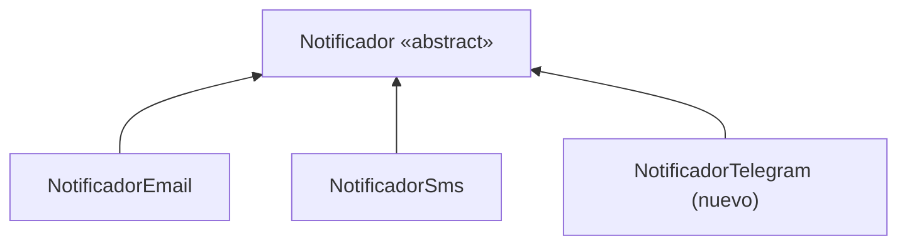
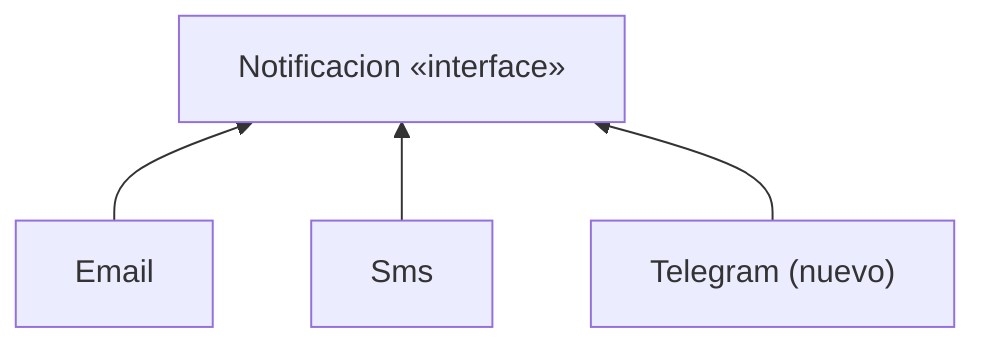
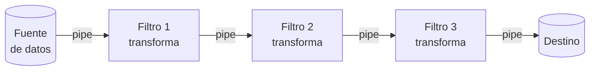
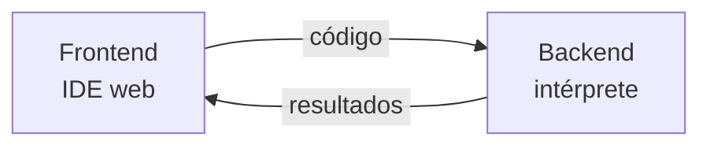
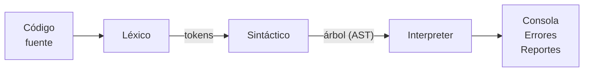
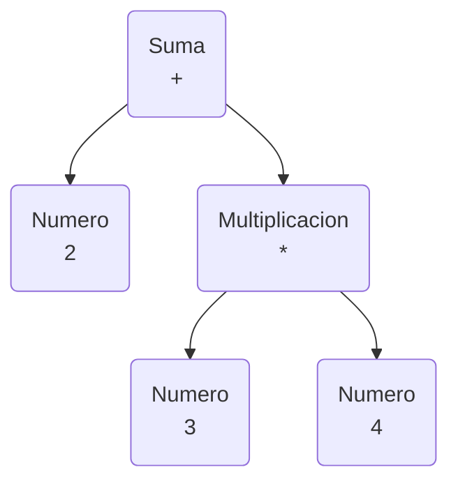
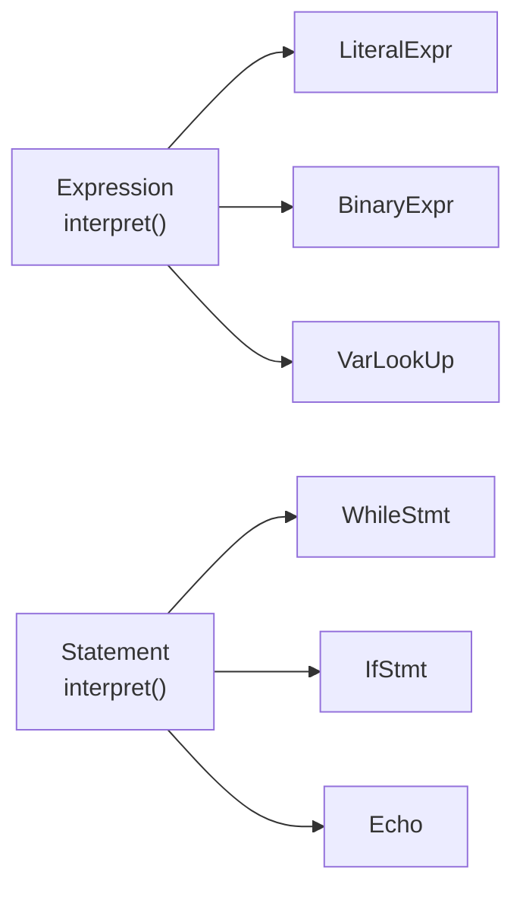

<div class="h-full flex flex-col justify-between">

<div class="kicker">Charla introductoria</div>

<div class="flex items-center justify-between">
  <div>
    <div class="cover-title"><span>Diseñar</span> antes<br/>de codificar</div>
    <div class="text-xl muted mt-6" style="max-width: 30rem">Patrones de Diseño y Arquitectura para Proyectos Escalables</div>
  </div>
  <svg width="300" height="230" viewBox="0 0 300 230" fill="none" class="shrink-0">
    <g stroke-width="1.5" style="stroke: var(--muted)">
      <line x1="150" y1="40" x2="80" y2="115" />
      <line x1="150" y1="40" x2="220" y2="115" />
      <line x1="220" y1="115" x2="170" y2="190" />
      <line x1="220" y1="115" x2="265" y2="190" />
    </g>
    <g text-anchor="middle" dominant-baseline="central" style="font: 500 17px 'JetBrains Mono', monospace">
      <circle cx="150" cy="40" r="24" style="fill: var(--accent)" />
      <text x="150" y="40" fill="#fff">+</text>
      <circle cx="80" cy="115" r="24" stroke-width="1.5" style="fill: var(--bg); stroke: var(--fg)" />
      <text x="80" y="115" style="fill: var(--fg)">2</text>
      <circle cx="220" cy="115" r="24" style="fill: var(--accent)" />
      <text x="220" y="115" fill="#fff">*</text>
      <circle cx="170" cy="190" r="24" stroke-width="1.5" style="fill: var(--bg); stroke: var(--fg)" />
      <text x="170" y="190" style="fill: var(--fg)">3</text>
      <circle cx="265" cy="190" r="24" stroke-width="1.5" style="fill: var(--bg); stroke: var(--fg)" />
      <text x="265" y="190" style="fill: var(--fg)">x</text>
    </g>
  </svg>
</div>

<div class="flex justify-between items-end pt-4" style="border-top: 1px solid var(--rule)">
  <div class="font-semibold">Alvaro Josué Morales Rodríguez</div>
  <div class="mono small muted">2 + 3 * x</div>
</div>

</div>

<!--
Bienvenida y presentación breve.
El árbol de la portada es la expresión 2 + 3 * x: al final de la charla vamos a ver cómo mi intérprete construye exactamente ese árbol.
Rompehielos: "¿Quién ha tenido que rehacer un proyecto desde cero porque ya no se podía modificar?"
-->

---

<div class="kicker">Quién presenta</div>

# Perfil del conferencista

<div class="grid grid-cols-2 gap-12">
<div>

<div class="display text-2xl font-semibold leading-tight">Alvaro Josué Morales Rodríguez</div>
<div class="mono small accent mt-1">Full-Stack Developer &amp; Cloud Administrator</div>

<div class="perfil-contacto mt-3">
  <div><span>GitHub</span>github.com/ELFBIBv</div>
  <div><span>LinkedIn</span>linkedin.com/in/alvaro-josue-morales</div>
  <div><span>Correo</span>jm54336720@gmail.com</div>
</div>

<div class="mt-4">
  <div class="flex justify-between items-baseline small">
    <div>Ing. en Ciencias y Sistemas <span class="muted">· USAC</span></div>
    <div class="accent font-semibold">9.º semestre</div>
  </div>
  <div class="perfil-barra mt-2"><div style="width: 90%"></div></div>
  <div class="small mt-3">Tutor líder de computación <span class="muted">· TutoMath</span></div>
</div>

</div>
<div>

<div class="eyebrow">Habilidades clave</div>
<div class="perfil-skills">
  <div><span>Java / Go / Python</span><span>Intermedio</span></div>
  <div><span>React / Node</span><span>Semi-avanzado</span></div>
  <div><span>Docker / Linux</span><span>Semi-avanzado</span></div>
  <div><span>AWS Cloud</span><span>Intermedio</span></div>
  <div><span>Ciberseguridad</span><span>Intermedio</span></div>
</div>

</div>
</div>

<div class="eyebrow mt-5">Proyectos destacados</div>
<div class="grid grid-cols-4 gap-6">
  <div class="ruled">
    <div class="num">01</div>
    <h3>Infraestructura cloud</h3>
    <div class="small muted">EC2, S3, API Gateway y DynamoDB en producción.</div>
  </div>
  <div class="ruled">
    <div class="num">02</div>
    <h3>Automatización</h3>
    <div class="small muted">Bot de Discord para monitoreo y comandos remotos.</div>
  </div>
  <div class="ruled">
    <div class="num">03</div>
    <h3>IA integrada</h3>
    <div class="small muted">Chatbot con entrada de audio y documentos.</div>
  </div>
  <div class="ruled">
    <div class="num">04</div>
    <h3>Data Warehouse</h3>
    <div class="small muted">Esquema de constelación diseñado antes de los ETL.</div>
  </div>
</div>

<!--
Presentación personal breve, sin detenerse demasiado.
Mencionar que todo lo que se verá hoy viene de proyectos reales: los patrones no son teoría, son lo que permitió que esos proyectos crecieran.
El Data Warehouse es el mejor ejemplo de la charla: primero se diseñó el esquema de constelación y después se construyeron los flujos ETL.
Mencionar TutoMath: "he estado del otro lado, explicándole esto a gente que va empezando".
-->

---

<div class="kicker">Antes de empezar</div>

# Una historia que tal vez conocen

<div class="grid grid-cols-2 gap-10">
<div>

<div class="rows">
  <div><span>Semana 1</span><div><code>Main.java</code> funciona. Todo bien.</div></div>
  <div><span>Semana 2</span><div>"Solo agrego otro <code>if</code>…"</div></div>
  <div><span>Semana 3</span><div><code>Main.java</code> ya va por las 1,500 líneas.</div></div>
  <div><span>Semana 4</span><div>Arreglo un bug y aparecen dos.</div></div>
  <div><span>Semana 5</span><div>"Mejor lo hago otra vez desde cero."</div></div>
</div>

</div>
<div style="--slidev-code-font-size: 11.5px">

```java
// Main.java, línea 1,342
if (opcion == 1) {
    if (tipo.equals("admin")) {
        if (lista.size() > 0) {
            for (int i = 0; i < lista.size(); i++) {
                if (lista.get(i).getEstado() == 3) {
                    // ¿qué significa 3?
                    // ...
                }
            }
        }
    } else if (tipo.equals("usuario")) {
        // copiado y pegado del bloque de arriba
```

</div>
</div>

<div class="display text-2xl mt-8">
Escribir código es la parte fácil. Lo difícil es <span class="hl">cambiarlo</span> sin romper lo que ya funciona.
</div>

<!--
Contarlo con humor: todos hemos estado ahí.
El problema no fue no saber programar: fue nunca detenerse a pensar en la estructura.
-->

---

<div class="kicker">01 · Diseñar antes de codificar</div>

# ¿Qué significa diseñar?

<div class="grid grid-cols-5 gap-10 mt-2">
<div class="col-span-2">
  <div class="big" style="font-size: 7rem">100×</div>
  <div class="mt-4 leading-snug">más caro puede salir corregir en producción un error que en el diseño se arreglaba borrando una flecha.</div>
  <div class="small muted mt-3">Barry Boehm, <i>Software Engineering Economics</i> (1981)</div>
</div>
<div class="col-span-3">

<div class="ruled">

### Diseñar es

- Pensar qué responsabilidades existen
- Dividir el problema en partes (clases)
- Decidir cómo se comunican esas partes

</div>

<div class="ruled mt-6">

### Diseñar no es

- Escribir un documento de 100 páginas
- Hacer el diagrama UML perfecto
- Pasar meses sin programar

</div>

</div>
</div>

<div class="small muted mt-6">Con papel, lápiz y diez minutos alcanza.</div>

<!--
Analogía rápida: nadie construye una casa sin planos. Mover una pared en el plano es borrar una línea; en la casa construida es romperla.
-->

---

<div class="kicker">01 · Diseñar antes de codificar</div>

# ¿Qué es un proyecto escalable?

Uno que puede crecer sin derrumbarse. ¿Crecer en qué?

<div class="grid grid-cols-3 gap-8 mt-6">
  <div class="ruled">
    <div class="num">01</div>
    <h3>Funcionalidades</h3>
    <div class="small muted">Agregar cosas nuevas sin romper las que ya están.</div>
  </div>
  <div class="ruled">
    <div class="num">02</div>
    <h3>Equipo</h3>
    <div class="small muted">Que varias personas trabajen en el mismo código sin pisarse.</div>
  </div>
  <div class="ruled">
    <div class="num">03</div>
    <h3>Usuarios</h3>
    <div class="small muted">Más usuarios, más datos, más peticiones por segundo.</div>
  </div>
</div>

<div class="grid grid-cols-2 gap-10 mt-10">
<div>

<div class="eyebrow">Señales de alerta</div>

- Cada cambio rompe otra cosa
- Solo una persona entiende el código
- Para agregar algo hay que copiar y pegar algo ya existente

</div>
<div class="callout self-center">
Los <b>patrones de diseño</b> ayudan sobre todo con los dos primeros puntos. Los de <b>arquitectura</b>, con los tres.
</div>
</div>

<!--
Mucha gente piensa que "escalable" solo significa "aguanta muchos usuarios".
En la universidad lo que más duele es escalar en funcionalidades: el proyecto crece y se vuelve imposible de modificar.
-->

---

<div class="kicker">02 · Patrones</div>

# ¿Qué es un patrón?

<div class="display text-3xl leading-tight mt-2" style="max-width: 46rem">
Una <span class="hl">solución probada</span> a un problema que aparece una y otra vez.
</div>

<div class="grid grid-cols-2 gap-10 mt-8">
<div class="ruled">

### Es

- Una idea, una plantilla de solución
- Un vocabulario que comparten los programadores
- Independiente del lenguaje

</div>
<div class="ruled">

### No es

- Una librería que se descarga
- Código para copiar y pegar
- Algo que hay que usar porque sí

</div>
</div>

<div class="muted mt-8">
Como una receta de pepián: la receta no es el pepián. Cada quien lo cocina con lo que tiene, pero todos reconocen el platillo.
</div>

---

<div class="kicker">02 · Patrones</div>

# ¿De dónde vienen?

<div class="relative mt-6">
  <div class="absolute left-0 right-0" style="top: 3.1rem; height: 1.5px; background: var(--rule)"></div>
  <div class="grid grid-cols-5 gap-6 relative">
    <div>
      <div class="display text-3xl font-semibold">1977</div>
      <div class="w-3 h-3 rounded-full mt-2" style="background: var(--accent)"></div>
      <div class="font-semibold mt-4">A Pattern Language</div>
      <div class="small muted mt-1">Christopher Alexander, un arquitecto de edificios.</div>
    </div>
    <div>
      <div class="display text-3xl font-semibold">1987</div>
      <div class="w-3 h-3 rounded-full mt-2" style="background: var(--fg)"></div>
      <div class="font-semibold mt-4">Beck y Cunningham</div>
      <div class="small muted mt-1">Llevan la idea al software.</div>
    </div>
    <div>
      <div class="display text-3xl font-semibold">1994</div>
      <div class="w-3 h-3 rounded-full mt-2" style="background: var(--accent)"></div>
      <div class="font-semibold mt-4">Design Patterns</div>
      <div class="small muted mt-1">El "Gang of Four" publica 23 patrones de diseño.</div>
    </div>
    <div>
      <div class="display text-3xl font-semibold">1996</div>
      <div class="w-3 h-3 rounded-full mt-2" style="background: var(--fg)"></div>
      <div class="font-semibold mt-4">POSA</div>
      <div class="small muted mt-1">Patrones de arquitectura.</div>
    </div>
    <div>
      <div class="display text-3xl font-semibold">Hoy</div>
      <div class="w-3 h-3 rounded-full mt-2" style="background: var(--fg)"></div>
      <div class="font-semibold mt-4">En todos lados</div>
      <div class="small muted mt-1">Java, Js, Ts, Android, React, Fortran xd…</div>
    </div>
  </div>
</div>

<div class="flex gap-4 mt-12">
  <div class="big" style="font-size: 4.5rem; line-height: 0.8">“</div>
  <div>
    <div class="display text-xl leading-snug">Cada patrón describe un problema que ocurre una y otra vez en nuestro entorno, y luego describe el núcleo de la solución a ese problema.</div>
    <div class="small muted mt-3">Christopher Alexander, 1977</div>
  </div>
</div>

<!--
Dato curioso: los patrones de software nacieron de un arquitecto que escribía sobre cómo diseñar casas y ciudades.
El "Gang of Four" son Erich Gamma, Richard Helm, Ralph Johnson y John Vlissides. Erich Gamma después co-creó JUnit y trabajó en VS Code.
-->

---

<div class="kicker">02 · Patrones</div>

# Tipos de patrones

<div class="grid grid-cols-4 gap-6 ruled">
  <div>
    <div class="display font-semibold text-lg">Arquitectura</div>
    <div class="small muted">todo el sistema</div>
  </div>
  <div class="col-span-3">
    <div>Capas · Cliente-Servidor · MVC · <b>Pipes & Filters</b><span class="tag">hoy</span> · Microservicios</div>
    <div class="small muted mt-1">El plano de la ciudad: cómo se reparten y se comunican las piezas grandes.</div>
  </div>
</div>

<div class="grid grid-cols-4 gap-6 ruled mt-8">
  <div>
    <div class="display font-semibold text-lg">Diseño</div>
    <div class="small muted">unas pocas clases<br/>el plano de una casa</div>
  </div>
  <div>
    <div class="big" style="font-size: 3.2rem">5</div>
    <div class="font-semibold mt-3">Creacionales</div>
    <div class="small muted">cómo se crean los objetos</div>
  </div>
  <div>
    <div class="big" style="font-size: 3.2rem">7</div>
    <div class="font-semibold mt-3">Estructurales</div>
    <div class="small muted">cómo se combinan las piezas</div>
  </div>
  <div>
    <div class="big" style="font-size: 3.2rem">11</div>
    <div class="font-semibold mt-3">De comportamiento</div>
    <div class="small muted">cómo se reparten el trabajo</div>
  </div>
</div>

<div class="small muted mt-10">Son los 23 del libro del Gang of Four. En las siguientes tres diapositivas están todos.</div>

<!--
Lo importante aquí es la diferencia de escala: la arquitectura es el sistema completo, el diseño es un grupo de clases.
Los de diseño se agrupan en tres familias. Ahora los vemos todos, solo para que les suenen los nombres.
-->

---

<div class="kicker">02 · Patrones · Catálogo 1/3</div>

<div class="cat-head flex justify-between items-start">
<div>

# Creacionales

¿Quién hace el `new`, y cuándo?

</div>
<div class="text-right">
  <div class="big" style="font-size: 3.6rem">5</div>
  <div class="eyebrow mt-2">de 23</div>
</div>
</div>

<div class="patgrid" style="--cols: 5">
<Patron n="01" name="Factory Method" ex="Calendar.getInstance()" code hoy>Un método decide qué objeto crear, en vez de usar new</Patron>
<Patron n="02" name="Abstract Factory" ex="tema claro y tema oscuro">Crea familias de objetos que combinan entre sí</Patron>
<Patron n="03" name="Builder" ex="StringBuilder" code>Arma un objeto complicado paso a paso</Patron>
<Patron n="04" name="Prototype" ex="objeto.clone()" code>Crea un objeto nuevo copiando uno que ya existe</Patron>
<Patron n="05" name="Singleton" ex="Runtime.getRuntime()" code>Garantiza una sola instancia en todo el programa</Patron>
</div>

<div class="callout mt-8">Singleton es el más conocido y también el más abusado: en el fondo es una variable global con otro nombre. Úsenlo con cuidado.</div>

<!--
Los ejemplos de abajo de cada tarjeta son clases de Java que ya existen, o una comparación de la vida real.
Factory Method lo vemos a fondo en unos minutos.
-->

---

<div class="kicker">02 · Patrones · Catálogo 2/3</div>

<div class="cat-head flex justify-between items-start">
<div>

# Estructurales

¿Cómo junto piezas para formar algo más grande?

</div>
<div class="text-right">
  <div class="big" style="font-size: 3.6rem">7</div>
  <div class="eyebrow mt-2">de 23</div>
</div>
</div>

<div class="patgrid" style="--cols: 4">
<Patron n="06" name="Adapter" ex="Arrays.asList(arreglo)" code>Hace compatibles dos interfaces que no encajan</Patron>
<Patron n="07" name="Bridge" ex="control remoto y televisor">Separa la idea de su implementación para que cambien por separado</Patron>
<Patron n="08" name="Composite" ex="una carpeta mide lo que suman sus archivos y subcarpetas">Trata igual a un elemento y a un grupo de elementos</Patron>
<Patron n="09" name="Decorator" ex="BufferedReader envuelve a FileReader y le agrega readLine()">Envuelve un objeto en otro que le agrega funciones</Patron>
<Patron n="10" name="Facade" ex="tienda.comprar() llama por ti a inventario, pago y envío">Una sola clase sencilla que esconde un sistema complicado</Patron>
<Patron n="11" name="Flyweight" ex="10,000 árboles de un juego comparten un solo modelo 3D">Comparte los datos repetidos para ahorrar memoria</Patron>
<Patron n="12" name="Proxy" ex="carga una imagen pesada solo cuando se va a mostrar">Un intermediario que controla el acceso a otro objeto</Patron>
<div class="pt pt-note">Composite es la base del patrón Interpreter: un nodo que contiene otros nodos. Lo van a ver en el árbol de mi proyecto.</div>
</div>

<!--
Composite: Archivo y Carpeta tienen el mismo método tamaño(). El archivo devuelve lo que pesa; la carpeta recorre lo que tiene adentro y suma. Quien llama no sabe si tiene un archivo o una carpeta.
Decorator: el envoltorio implementa la misma interfaz que lo envuelto, así que se usa igual. Agrega comportamiento, no atributos, y se pueden apilar: new BufferedReader(new FileReader("a.txt")).
Facade: la clase Tienda tiene un solo método comprar() que por dentro habla con Inventario, Pagos y Envíos. Quien la usa no necesita conocer esas tres clases.
Flyweight: cada árbol guarda solo su posición; el modelo 3D, la textura y el color se comparten. En Java, Integer.valueOf(5) devuelve siempre el mismo objeto para números entre -128 y 127.
Proxy: tiene la misma interfaz que el objeto real y se pone en medio. Sirve para cargar algo solo cuando se necesita, revisar permisos o guardar en caché. Como una tarjeta de crédito: pagas igual que con efectivo, pero el banco valida cada pago.
-->

---

<div class="kicker">02 · Patrones · Catálogo 3/3</div>

<div class="cat-head flex justify-between items-start">
<div>

# De comportamiento

¿Quién hace qué, y cómo se avisan entre ellos?

</div>
<div class="text-right">
  <div class="big" style="font-size: 3.6rem">11</div>
  <div class="eyebrow mt-2">de 23</div>
</div>
</div>

<div class="patgrid" style="--cols: 6">
<Patron n="13" name="Chain of Responsibility" ex="soporte por niveles">Pasa la petición hasta que alguien la atiende</Patron>
<Patron n="14" name="Command" ex="la comanda del mesero">Convierte una acción en un objeto</Patron>
<Patron n="15" name="Interpreter" ex="Pattern.compile()" code hoy>Cada regla de una gramática se vuelve una clase</Patron>
<Patron n="16" name="Iterator" ex="for (x : lista)" code>Recorre una colección sin saber cómo está hecha</Patron>
<Patron n="17" name="Mediator" ex="la torre de control">Un objeto central coordina a todos los demás</Patron>
<Patron n="18" name="Memento" ex="Ctrl + Z" code>Guarda el estado de un objeto para volver a él</Patron>
<Patron n="19" name="Observer" ex="addActionListener" code>Avisa a todos los suscritos cuando algo cambia</Patron>
<Patron n="20" name="State" ex="un semáforo">El objeto se comporta distinto según su estado</Patron>
<Patron n="21" name="Strategy" ex="Comparator" code>Cambia el algoritmo sin tocar a quien lo usa</Patron>
<Patron n="22" name="Template Method" ex="una receta">Define los pasos; las subclases rellenan algunos</Patron>
<Patron n="23" name="Visitor" ex="recorrer un árbol">Agrega operaciones sin modificar las clases</Patron>
<div class="pt pt-note">refactoring.guru muestra 10: deja fuera Interpreter, que sí está en el libro original.</div>
</div>

<!--
refactoring.guru muestra 22 patrones: deja fuera Interpreter porque casi solo se usa para construir lenguajes. En el libro original sí está, y es justo el de mi proyecto.
Visitor es su pariente cercano: muchos compiladores lo usan para recorrer el árbol sin meter más métodos en cada nodo.
-->

---

<div class="kicker">02 · Patrones</div>

# Ya los usan sin saberlo

La librería estándar de Java está llena de patrones.

| Código que ya conocen | Patrón |
|---|---|
| `for (String s : lista) { … }` | Iterator |
| `boton.addActionListener(e -> …)` | Observer |
| `Runtime.getRuntime()` | Singleton |
| `Calendar.getInstance()` | Factory |
| `new BufferedReader(new FileReader("a.txt"))` | Decorator |
| `Pattern.compile("[a-z]+")` | Interpreter |

<!--
Cada vez que usan un for-each hay un Iterator por debajo. Cada ActionListener de Swing es un Observer.
-->

---

<div class="kicker">02 · Patrones</div>

# Ventajas y desventajas

<div class="grid grid-cols-2 gap-10 mt-2">
<div class="ruled">

### A favor

- Vocabulario común con tu equipo
- Soluciones probadas durante décadas
- Agregar cosas sin romper lo que ya existe
- Código más fácil de mantener y de probar

</div>
<div class="ruled">

### En contra

- Sobreingeniería: un patrón donde bastaba un `if`
- Más clases; al inicio cuesta seguir el flujo
- Hay que entender la intención, no solo copiar
- "Si solo tienes un martillo, todo parece un clavo"

</div>
</div>

<div class="display text-2xl mt-12">
Un patrón mal aplicado es peor que <span class="hl">no usar ninguno</span>.
</div>

---

<div class="kicker">02 · Patrones</div>

# Recomendaciones

<div class="grid grid-cols-5 gap-12 mt-4">
<div class="col-span-2">
  <div class="mb-6">
    <div class="big text-4xl">KISS</div>
    <div class="small muted mt-2">Keep it simple. Mantenlo simple.</div>
  </div>
  <div class="mb-6">
    <div class="big text-4xl">YAGNI</div>
    <div class="small muted mt-2">You aren't gonna need it. No programes para un futuro que te imaginas.</div>
  </div>
  <div>
    <div class="big text-4xl">DRY</div>
    <div class="small muted mt-2">Don't repeat yourself. Cada lógica en un solo lugar.</div>
  </div>
</div>
<div class="col-span-3 ruled">

1. **Primero el problema, después el patrón.** Nunca al revés.
2. **Empiecen simple** y usen un patrón cuando el problema de verdad aparezca.
3. **Dibujen antes de programar**, aunque sea en una hoja.
4. **Aprendan primero los básicos:** Factory Method, Singleton, Strategy y Observer.
5. **Practiquen en los proyectos del curso.** Son el mejor laboratorio.

</div>
</div>

---

<div class="kicker">03 · Factory Method</div>

# El problema

<div class="grid grid-cols-5 gap-10">
<div class="col-span-3">

```java
public class Main {
    public static void main(String[] args) {
        String canal = args[0];   // "EMAIL", "SMS"...
        if (canal.equals("EMAIL")) {
            Email email = new Email();
            email.enviar("Tu pedido va en camino");
        } else if (canal.equals("SMS")) {
            Sms sms = new Sms();
            sms.enviar("Tu pedido va en camino");
        }
        // este if/else también está copiado en
        // aprobarPago(), enviarFactura()... 10 veces
    }
}
```

</div>
<div class="col-span-2">

<div class="rows">
  <div><span>01</span><div><code>Main</code> conoce todas las clases concretas.</div></div>
  <div><span>02</span><div>Agregar WhatsApp obliga a tocar cada <code>if/else</code>.</div></div>
  <div><span>03</span><div>La lógica de creación está repetida por todo el proyecto.</div></div>
</div>

</div>
</div>

<!--
Factory Method es un patrón creacional y probablemente el más fácil para empezar.
El problema no es el new en sí: es que la decisión de QUÉ crear está regada por todo el programa.
En un proyecto real no se manda un solo mensaje: se manda al confirmar el pedido, al aprobar el pago, al enviar la factura... Cada uno de esos métodos copia el mismo if/else. Si llega WhatsApp hay que encontrar y cambiar las 10 copias, y si se olvida una, hay un bug.
-->

---

<div class="kicker">03 · Factory Method</div>

# La idea

<div class="grid grid-cols-5 gap-10">
<div class="col-span-2">
<svg class="uml" viewBox="0 0 300 372" width="300" height="372" aria-label="Diagrama de clases de Factory Method">
  <rect class="box" x="10" y="1" width="240" height="81"/>
  <text class="st" x="130" y="17" text-anchor="middle">«abstract»</text>
  <text class="name" x="130" y="33" text-anchor="middle">Notificador</text>
  <line class="sep" x1="10" y1="43" x2="250" y2="43"/>
  <text class="m" x="20" y="60">+ notificar(mensaje)</text>
  <text class="m acc" x="20" y="75"># crearNotificacion(): Notificacion</text>
  <line class="ln" x1="130" y1="118" x2="130" y2="92"/>
  <polygon class="tri" points="130,82 124,92 136,92"/>
  <text class="lbl" x="138" y="106">hereda</text>
  <rect class="box" x="10" y="118" width="240" height="52"/>
  <text class="name" x="130" y="138" text-anchor="middle">NotificadorSms</text>
  <line class="sep" x1="10" y1="148" x2="250" y2="148"/>
  <text class="m acc" x="20" y="163"># crearNotificacion(): Notificacion</text>
  <line class="ln acc dash" x1="130" y1="170" x2="130" y2="204"/>
  <polyline class="ln acc" points="125,198 130,205 135,198"/>
  <text class="lbl acc" x="138" y="191">crea</text>
  <rect class="box" x="10" y="206" width="240" height="52"/>
  <text class="name" x="130" y="226" text-anchor="middle">Sms</text>
  <line class="sep" x1="10" y1="236" x2="250" y2="236"/>
  <text class="m" x="20" y="251">+ enviar(mensaje)</text>
  <line class="ln dash" x1="130" y1="258" x2="130" y2="284"/>
  <polygon class="tri" points="130,294 124,284 136,284"/>
  <text class="lbl" x="138" y="275">implementa</text>
  <rect class="box" x="10" y="294" width="240" height="76"/>
  <text class="st" x="130" y="310" text-anchor="middle">«interface»</text>
  <text class="name" x="130" y="326" text-anchor="middle">Notificacion</text>
  <line class="sep" x1="10" y1="336" x2="250" y2="336"/>
  <text class="m" x="20" y="355">+ enviar(mensaje)</text>
  <path class="ln dash" d="M250 42H272V332H253"/>
  <polyline class="ln" points="257,327 251,332 257,337"/>
  <text class="lbl" x="277" y="190">usa</text>
</svg>
</div>
<div class="col-span-3">

<div class="callout display text-lg">
Define un método para crear objetos, pero deja que las subclases decidan qué clase crear.
<span class="small muted" style="font-family: Inter">Gang of Four</span>
</div>

<div class="eyebrow mt-7">Los creadores</div>

- `Notificador` tiene la lógica común y declara `crearNotificacion()`
- `NotificadorSms` decide qué objeto se crea

<div class="eyebrow mt-5">Los productos</div>

- `Notificacion` es lo que todos saben hacer: `enviar()`
- `Sms` es una forma concreta de hacerlo

<div class="display text-xl mt-7">
Separamos <span class="hl">usar</span> un objeto de <span class="hl">crearlo</span>.
</div>
<div class="small muted mt-1">Toda la creación pasa por un solo método.</div>

</div>
</div>

<!--
Fíjense en el orden: primero el diagrama (diseño) y después el código. Eso es diseñar antes de codificar.
Antes de ver el código, la misma idea con un videojuego.
-->

---

<div class="kicker">03 · Factory Method</div>

# Piénsenlo como un videojuego

Todos los niveles funcionan igual: aparece un enemigo y te ataca. Lo único que cambia es <b>cuál</b>.

<div class="grid grid-cols-5 gap-8 mt-4">
<div class="col-span-3">
<svg class="uml" viewBox="0 0 520 254" width="508" height="248" aria-label="Las reglas del nivel dejan un hueco y cada nivel decide qué enemigo lo llena">
  <rect class="box" x="1" y="1" width="518" height="98" rx="8"/>
  <text class="name" x="16" y="24">Nivel</text>
  <text class="st" x="56" y="24">las reglas del juego</text>
  <rect class="step" x="16" y="38" width="150" height="46" rx="6"/>
  <text class="tx" x="30" y="65.5">1. aparece un</text>
  <circle class="dot" cx="134" cy="61" r="12"/>
  <text class="q" x="134" y="61">?</text>
  <line class="ln" x1="172" y1="61" x2="194" y2="61"/>
  <polyline class="ln" points="189,56 195,61 189,66"/>
  <rect class="step" x="202" y="38" width="150" height="46" rx="6"/>
  <text class="tx" x="216" y="65.5">2. te ataca</text>
  <text class="lbl" x="374" y="57">se programan</text>
  <text class="lbl" x="374" y="71">una sola vez</text>
  <line class="ln acc dash" x1="134" y1="73" x2="134" y2="124"/>
  <text class="tx acc" x="144" y="117">cada nivel decide qué es el ?</text>
  <line class="ln acc dash" x1="81" y1="124" x2="439" y2="124"/>
  <line class="ln acc dash" x1="81" y1="124" x2="81" y2="148"/>
  <line class="ln acc dash" x1="260" y1="124" x2="260" y2="148"/>
  <line class="ln acc dash" x1="439" y1="124" x2="439" y2="148"/>
  <polyline class="ln acc" points="76,142 81,149 86,142"/>
  <polyline class="ln acc" points="255,142 260,149 265,142"/>
  <polyline class="ln acc" points="434,142 439,149 444,142"/>
  <rect class="box" x="1" y="150" width="160" height="74" rx="8"/>
  <text class="name" x="81" y="176" text-anchor="middle">Nivel bosque</text>
  <circle class="dot" cx="59" cy="201" r="10"/>
  <text class="q" x="59" y="201">?</text>
  <text class="tx" x="75" y="205.5">= lobo</text>
  <rect class="box" x="180" y="150" width="160" height="74" rx="8"/>
  <text class="name" x="260" y="176" text-anchor="middle">Nivel desierto</text>
  <circle class="dot" cx="222" cy="201" r="10"/>
  <text class="q" x="222" y="201">?</text>
  <text class="tx" x="238" y="205.5">= escorpión</text>
  <rect class="nuevo" x="359" y="150" width="160" height="74" rx="8"/>
  <text class="name" x="439" y="176" text-anchor="middle">Nivel nieve</text>
  <circle class="dot" cx="417" cy="201" r="10"/>
  <text class="q" x="417" y="201">?</text>
  <text class="tx" x="433" y="205.5">= yeti</text>
  <text class="lbl acc" x="439" y="244" text-anchor="middle">nuevo: las reglas no se tocan</text>
</svg>
</div>
<div class="col-span-2">

<div class="eyebrow">Traducido a Java</div>

<div class="glosa">
  <div><span>Nivel</span><code>Notificador</code></div>
  <div><span>las reglas</span><code>notificar()</code></div>
  <div><span>el <b class="accent">?</b></span><code>crearNotificacion()</code></div>
  <div><span>Nivel bosque</span><code>NotificadorSms</code></div>
  <div><span>un enemigo</span><code>Notificacion</code></div>
  <div><span>el lobo</span><code>Sms</code></div>
  <div><span>el jugador</span><code>main</code></div>
</div>

<div class="callout mt-4">
Ese <b>?</b> es el <span class="hl">factory method</span>. Las reglas lo usan sin saber qué bicho va a salir.
</div>

</div>
</div>

<!--
Pregunten: ¿quién ha jugado algo con niveles? Casi todos los juegos funcionan así.
Las reglas del nivel se programan una sola vez: aparece un enemigo y te ataca. Pero ahí no dice "lobo" ni "escorpión": dejan un hueco, el ?, y cada nivel lo llena.
Ese hueco es crearNotificacion(). Las reglas son notificar(). El lobo es Sms.
Si mañana sale el nivel de nieve con un yeti, las reglas ni se tocan. Eso mismo va a pasar con Telegram.
-->

---

<div class="kicker">03 · Factory Method</div>

# El código

<div style="--slidev-code-font-size: 12px; --slidev-code-line-height: 17px">

<div class="grid grid-cols-2 gap-5">
<div>

<div class="eyebrow">1 · El producto <span class="accent">· el enemigo</span></div>

````md magic-move {at: 1}
```java
interface Notificacion {
    void enviar(String mensaje);
}

class Sms implements Notificacion {
    public void enviar(String mensaje) {
        System.out.println("[SMS] " + mensaje);
    }
}
```
```java {5-9}
interface Notificacion { ... }

class Sms implements Notificacion { ... }

class Telegram implements Notificacion {
    public void enviar(String mensaje) {
        System.out.println("[TELEGRAM] " + mensaje);
    }
}
```
````

</div>
<div>

<div class="eyebrow">2 · El creador <span class="accent">· los niveles</span></div>

````md magic-move {at: 1}
```java
abstract class Notificador {
    // el factory method: el "?"
    abstract Notificacion crearNotificacion();

    void notificar(String mensaje) {   // las reglas
        crearNotificacion().enviar(mensaje);
    }
}

class NotificadorSms extends Notificador {
    Notificacion crearNotificacion() {
        return new Sms();
    }
}
```
```java {5-9}
abstract class Notificador { ... }

class NotificadorSms extends Notificador { ... }

class NotificadorTelegram extends Notificador {
    Notificacion crearNotificacion() {
        return new Telegram();
    }
}
```
````

</div>
</div>

<div class="eyebrow mt-3">3 · El cliente, que ya no sabe que existe Sms <span class="accent">· el jugador</span></div>

````md magic-move {at: 1}
```java
Notificador notificador = new NotificadorSms();
notificador.notificar("Tu pedido va en camino");   // [SMS] Tu pedido va en camino
```
```java
Notificador notificador = new NotificadorTelegram();
notificador.notificar("Tu pedido va en camino");   // [TELEGRAM] Tu pedido va en camino
```
````

<div v-click="1" class="callout mt-5">
¿Llega Telegram? Solo se <span class="hl">agrega</span> código: dos clases nuevas. <code>Notificador</code> y <code>Sms</code> ni se tocan, y el cliente solo escoge otro nivel.
</div>

</div>

<!--
Puntos clave: crearNotificacion() es abstracto, así que Notificador no sabe qué va a crear.
notificar() usa el producto a través de la interfaz. Cada subclase decide solo la parte de "qué crear".
Antes de dar clic, pregunten: si mañana piden Telegram, ¿qué hay que cambiar? Dejen que respondan.

[click] Lo que ya existía se pliega y se apaga (sigue igual) y solo aparece lo nuevo: Telegram y NotificadorTelegram. Es el nivel de nieve con el yeti.
-->

---

<div class="kicker">03 · Factory Method</div>

# El Main, antes y después

<div class="grid grid-cols-5 gap-8">
<div class="col-span-2">

<div class="eyebrow">Antes · dentro de main</div>

<div style="--slidev-code-font-size: 11.5px; --slidev-code-line-height: 16px">

```java
String canal = args[0];
if (canal.equals("EMAIL")) {
    Email email = new Email();
    email.enviar("Tu pedido va en camino");
} else if (canal.equals("SMS")) {
    Sms sms = new Sms();
    sms.enviar("Tu pedido va en camino");
}
// copiado también en aprobarPago(),
// enviarFactura()... 10 veces
```

</div>

<div class="callout mt-6">
El <code>if</code> no desaparece: queda en <span class="hl">un solo lugar</span>. Los demás lugares solo llaman a <code>notificar()</code> y no saben que existen <code>Email</code> ni <code>Sms</code>.
</div>

</div>
<div class="col-span-3">

<div class="eyebrow">Después</div>

<div style="--slidev-code-font-size: 12px; --slidev-code-line-height: 17px">

```java
public class Main {
    public static void main(String[] args) {
        Notificador notificador = elegir(args[0]);
        notificador.notificar("Tu pedido va en camino");
        // aprobarPago(), enviarFactura()... hacen
        // lo mismo: notificador.notificar(...)
    }

    // el único lugar que sabe qué canales existen
    static Notificador elegir(String canal) {
        if (canal.equals("EMAIL")) {
            return new NotificadorEmail();
        } else {
            return new NotificadorSms();
        }
    }
}
```

</div>

</div>
</div>

<!--
elegir() es una fábrica sencilla: la única parte del programa que sabe qué canales existen. El Factory Method está en crearNotificacion(): cada Notificador decide qué objeto crea.
main ya no hace new Email() ni new Sms(). Trabaja con Notificador y nada más.
-->

---

<div class="kicker">03 · Factory Method</div>

# Llega un requisito nuevo: Telegram

<div class="grid grid-cols-5 gap-8">
<div class="col-span-2">

<div class="eyebrow">Creadores</div>



<div class="eyebrow mt-4">Productos</div>



</div>
<div class="col-span-3">

```java
class Telegram implements Notificacion {
    public void enviar(String mensaje) {
        System.out.println("[TELEGRAM] " + mensaje);
    }
}

class NotificadorTelegram extends Notificador {
    Notificacion crearNotificacion() {
        return new Telegram();
    }
}
```

<div class="callout mt-5">
Dos clases nuevas y una línea más en <code>elegir()</code>. Lo que ya funcionaba no se toca: <span class="hl">eso es escalar</span>.
</div>

<div class="small muted mt-4">
Vale la pena cuando esperas que aparezcan tipos nuevos. Si solo hay uno, sobra.
</div>

</div>
</div>

<!--
Este es el nivel de nieve: Telegram es el yeti y NotificadorTelegram es el nivel nuevo. Las reglas (Notificador) ni se tocaron.
-->

---

<div class="kicker">04 · Arquitectura</div>

# Pipes & Filters

Un patrón de arquitectura que no es MVC: los datos pasan por una línea de ensamblaje.



<div class="grid grid-cols-5 gap-10 mt-4">
<div class="col-span-2">

- **Filtro:** recibe datos, los transforma y los entrega. No sabe quién está antes ni después.
- **Pipe:** conecta la salida de un filtro con la entrada del siguiente.

</div>
<div class="col-span-3">

<div class="eyebrow">Ya lo conocen: Java Streams</div>

```java
List<String> aprobados = estudiantes.stream() // fuente
    .filter(e -> e.getNota() >= 61)           // filtro 1
    .sorted(Comparator.comparing(Estudiante::getNota)
                      .reversed())            // filtro 2
    .map(Estudiante::getNombre)               // filtro 3
    .toList();                                // destino
```

</div>
</div>

<div class="callout mt-4">
Cada etapa hace una sola cosa, así que se pueden agregar, quitar o cambiar etapas sin rediseñar todo. Lo usan los compiladores, los editores de imágenes y los servidores web.
</div>

<!--
Este es el patrón de arquitectura de la charla, distinto a MVC.
Analogía extra: una planta purificadora de agua. El agua pasa por arena, carbón, cloro... cada etapa hace una sola cosa.
-->

---

<div class="kicker">05 · Caso real</div>

# Mi intérprete de OLC1

<div class="grid grid-cols-2 gap-10">
<div>

<div class="display text-xl leading-snug">
La idea: crear <span class="hl">un lenguaje de programación propio</span> y un IDE web donde se escribe, se ejecuta y se ve su árbol.
</div>

<div class="small muted mt-6">El reto no es el lenguaje en sí, sino cómo organizar el código para que pueda crecer: cada instrucción nueva no debería romper las anteriores.</div>

</div>
<div>

<div class="eyebrow">factorial.ci</div>

```ts
function int factorial(n: int) {
    if (n <= 1) {
        return 1;
    }
    return n * factorial(n = n - 1);
}

function void main() {
    echo "5! = ", factorial(n = 5);
}

ejecutar main();
```

<div class="output mt-3"><div class="eyebrow">Salida</div>5! = 120</div>

</div>
</div>

<!--
No hace falta entrar en todo lo que soporta el lenguaje. Lo importante es la intención y cómo está diseñado por dentro.
-->

---

<div class="kicker">05 · Caso real</div>

# Cómo está armado

<div class="eyebrow">Cliente-Servidor · el navegador manda el código y el servidor lo interpreta</div>



<div class="eyebrow mt-6">Pipes & Filters · dentro del servidor, el código pasa por etapas</div>



<div class="callout mt-4">
Cada etapa hace una sola cosa y le pasa su resultado a la siguiente. La última etapa es donde entra el patrón Interpreter.
</div>

<!--
Dos arquitecturas: Cliente-Servidor por fuera y Pipes & Filters por dentro.
-->

---

<div class="kicker">05 · Caso real</div>

# El patrón Interpreter

<div class="display text-xl leading-snug" style="max-width: 50rem">
Cada regla del lenguaje se convierte en <span class="hl">una clase</span>, y cada clase sabe evaluarse a sí misma.
</div>

<div class="grid grid-cols-5 gap-8 mt-6 items-center">
<div class="col-span-3">

```java
interface Expresion { int interpretar(); }

class Numero implements Expresion {      // hoja
    int valor;
    public int interpretar() { return valor; }
}

class Suma implements Expresion {        // nodo
    Expresion izq, der;
    public int interpretar() {
        return izq.interpretar() + der.interpretar();
    }
}
```

</div>
<div class="col-span-2">



<div class="text-center small muted">El programa <code>2 + 3 * 4</code> se guarda como un árbol (AST)</div>

</div>
</div>

<!--
Se usa en calculadoras, fórmulas de Excel, expresiones regulares, SQL... y en lenguajes de programación.
Suma no sabe multiplicar: solo les pide a sus hijos que se evalúen y suma los resultados.
-->

---

<div class="kicker">05 · Caso real</div>

# Cómo lo usé en el proyecto

<div class="grid grid-cols-2 gap-10 items-center">
<div>



<div class="text-center small muted">Dos clases abstractas y una clase por cada instrucción del lenguaje</div>

</div>
<div>

- El analizador **solo construye el árbol**; no ejecuta nada.
- Para correr el programa se llama `interpret()` en la raíz y cada nodo evalúa a sus hijos.
- Un `while` simplemente vuelve a pedirle a su condición y a su cuerpo que se interpreten.
- Agregar una instrucción nueva es **agregar una clase**, sin tocar las que ya existen.

</div>
</div>

<!--
Momento para la demo en vivo: escribir un programa en el IDE, ejecutarlo y mostrar la gráfica del árbol.
La idea que deben llevarse: el lenguaje crece agregando clases, igual que con Factory Method.
-->

---

<div class="kicker">05 · Caso real</div>

# Un `while` como árbol

<div class="grid grid-cols-5 gap-8">
<div class="col-span-2">

```ts
int i = 1;
while (i < 3) {
    echo i * 2;
    i++;
}
```

<div class="mt-5">

1. `While` le pide a su condición `i < 3` que se interprete.
2. Si es `true`, interpreta cada hijo de `Statements`.
3. Vuelve a preguntar la condición y repite.

</div>

<div class="small muted mt-4">El <code>While</code> no sabe comparar ni imprimir: solo coordina a sus hijos.</div>

</div>
<div class="col-span-3">

<svg viewBox="0 0 580 340" class="ast-tree w-full">
<defs><marker id="ast-arrow" viewBox="0 0 10 10" refX="9" refY="5" markerWidth="7" markerHeight="7" orient="auto"><path d="M0,0 L10,5 L0,10 z" class="ast-arrowhead"/></marker></defs>
<g class="ast-node"><rect x="230" y="6" width="120" height="36" rx="3"/><text x="290" y="28">While</text></g>
<g v-click><path class="ast-edge" d="M290,42 V60 H140 V76" marker-end="url(#ast-arrow)"/><g class="ast-node acc"><rect x="65" y="78" width="150" height="36" rx="3"/><text x="140" y="100">operacion binaria: &lt;</text></g></g>
<g v-click><path class="ast-edge" d="M140,114 V132 H70 V148" marker-end="url(#ast-arrow)"/><g class="ast-node acc"><rect x="10" y="150" width="120" height="36" rx="3"/><text x="70" y="172">Variable: i</text></g></g>
<g v-click><path class="ast-edge" d="M140,114 V132 H210 V148" marker-end="url(#ast-arrow)"/><g class="ast-node acc"><rect x="150" y="150" width="120" height="36" rx="3"/><text x="210" y="172">value:3</text></g></g>
<g v-click><path class="ast-edge" d="M290,42 V60 H440 V76" marker-end="url(#ast-arrow)"/><g class="ast-node"><rect x="380" y="78" width="120" height="36" rx="3"/><text x="440" y="100">Statements</text></g></g>
<g v-click><path class="ast-edge" d="M440,114 V132 H360 V148" marker-end="url(#ast-arrow)"/><g class="ast-node"><rect x="300" y="150" width="120" height="36" rx="3"/><text x="360" y="172">Echo</text></g></g>
<g v-click><path class="ast-edge" d="M360,186 V220" marker-end="url(#ast-arrow)"/><g class="ast-node acc"><rect x="285" y="222" width="150" height="36" rx="3"/><text x="360" y="244">operacion binaria: *</text></g></g>
<g v-click><path class="ast-edge" d="M360,258 V276 H290 V292" marker-end="url(#ast-arrow)"/><g class="ast-node acc"><rect x="230" y="294" width="120" height="36" rx="3"/><text x="290" y="316">Variable: i</text></g></g>
<g v-click><path class="ast-edge" d="M360,258 V276 H430 V292" marker-end="url(#ast-arrow)"/><g class="ast-node acc"><rect x="370" y="294" width="120" height="36" rx="3"/><text x="430" y="316">value:2</text></g></g>
<g v-click><path class="ast-edge" d="M440,114 V132 H510 V148" marker-end="url(#ast-arrow)"/><g class="ast-node"><rect x="450" y="150" width="120" height="36" rx="3"/><text x="510" y="172">Incremento</text></g></g>
<g v-click><path class="ast-edge" d="M510,186 V220" marker-end="url(#ast-arrow)"/><g class="ast-node"><rect x="450" y="222" width="120" height="36" rx="3"/><text x="510" y="244">identificador:i</text></g></g>
</svg>

<div class="text-center small muted">En color, las expresiones: lo que devuelve un valor</div>

</div>
</div>

<!--
Los nombres de los nodos son los mismos que genera el proyecto con graph().
La condición es una expresión (BinaryExpr), y adentro hay una instrucción con una expresión (Echo con i * 2) y una instrucción sencilla (Incremento).
-->

<style>
.ast-tree { font-family: 'Segoe UI', Helvetica, Arial, sans-serif; }
.ast-node rect { fill: #ffffff; stroke: var(--fg); stroke-width: 1; }
.ast-node.acc rect { fill: var(--accent-soft); stroke: var(--accent); stroke-width: 2; }
.ast-node text { fill: var(--fg); font-size: 12.5px; text-anchor: middle; }
.ast-edge { fill: none; stroke: var(--muted); stroke-width: 1.3; }
.ast-arrowhead { fill: var(--muted); }
html.dark .ast-node rect { fill: var(--surface); stroke: #d4d4d8; }
html.dark .ast-node.acc rect { fill: var(--accent-soft); stroke: var(--accent); }
</style>

---

<div class="h-full flex flex-col justify-between">

<div>
  <div class="kicker">Para llevar</div>
  <div class="cover-title" style="font-size: 3.6rem">Gracias<span>.</span></div>
  <div class="text-xl muted mt-3">¿Preguntas?</div>
</div>

<div class="grid grid-cols-4 gap-6">
  <div class="ruled">
    <div class="num">01</div>
    <div class="font-semibold">Diseñar antes</div>
    <div class="small muted mt-1">Los errores se corrigen en papel, no en producción.</div>
  </div>
  <div class="ruled">
    <div class="num">02</div>
    <div class="font-semibold">Factory Method</div>
    <div class="small muted mt-1">Tipos nuevos sin modificar el código que ya funciona.</div>
  </div>
  <div class="ruled">
    <div class="num">03</div>
    <div class="font-semibold">Pipes & Filters</div>
    <div class="small muted mt-1">Etapas independientes que se agregan o cambian sin rediseñar todo.</div>
  </div>
  <div class="ruled">
    <div class="num">04</div>
    <div class="font-semibold">Interpreter</div>
    <div class="small muted mt-1">El lenguaje crece agregando clases, sin tocar las que ya existen.</div>
  </div>
</div>

<div class="flex justify-between small muted pt-4" style="border-top: 1px solid var(--rule)">
  <span>Alvaro Josué Morales Rodríguez</span>
  <span>Para seguir: refactoring.guru/es/design-patterns</span>
</div>

</div>
